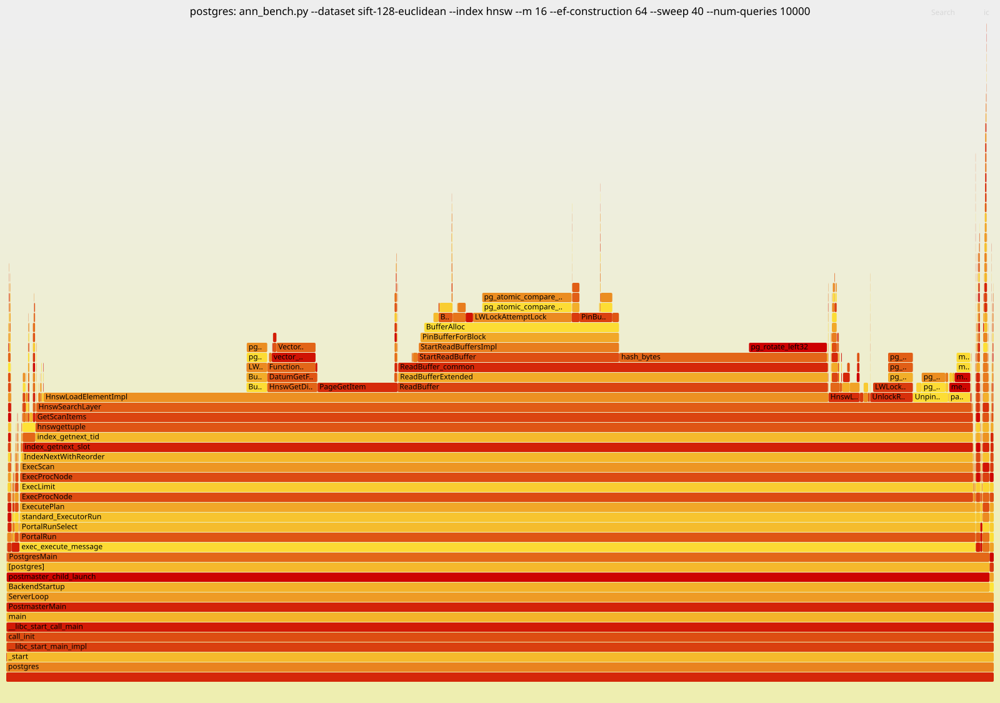

# pgvector ANN benchmark: SIFT-1M baseline (2026-11-01)

## Summary

- **HNSW** (m=16, ef_construction=64): 0.93 recall@10 at 990 QPS, 0.99 at 380 QPS (1 client).
  Throughput scales to 5,750 QPS with 8 clients.
- **IVFFlat** (lists=1000) needs about 5x more time per query than HNSW for the same
  recall, but builds in 8 s vs. 54 s.
- **Exact scan:** 10.7 QPS, 35x slower than HNSW at 0.99 recall.
- **HNSW queries are dominated by buffer access, not vector math.** About 45% of CPU goes
  to `ReadBuffer` on pages that are already cached, and distance computation is under 5%.

## Setup

- AMD Ryzen AI 7 PRO 350 (8 cores / 16 threads), 26 GiB RAM, Ubuntu 26.04, Linux 7.0
- PostgreSQL 17.11 (meson `debugoptimized`, `-O2 -g`), pgvector v0.8.7 (`-march=native`)
- `shared_buffers=4GB`, which holds the whole table and index. Index builds used
  `maintenance_work_mem=2GB` and 7 parallel workers. All other settings are defaults.
- Dataset: `sift-128-euclidean` from ann-benchmarks (1M x 128, L2), 1,000 queries, k=10
- Client: Python + psycopg on the same machine, using prepared statements. Latency is
  measured on the client.

## Results

**HNSW** (m=16, ef_construction=64). Build 54 s, index 782 MiB.

| ef_search | recall@10 | QPS | p50 ms | p99 ms |
|---:|---:|---:|---:|---:|
| 10 | 0.725 | 1,744 | 0.51 | 1.61 |
| 20 | 0.848 | 1,175 | 0.76 | 2.01 |
| 40 | 0.929 | 990 | 0.97 | 1.88 |
| 80 | 0.973 | 622 | 1.53 | 2.92 |
| 160 | 0.993 | 381 | 2.62 | 5.00 |
| 320 | 0.998 | 196 | 5.06 | 8.61 |

**HNSW with concurrent clients:**

| clients | QPS at ef_search=40 | QPS at ef_search=160 |
|---:|---:|---:|
| 1 | 990 | 381 |
| 4 | 3,614 | 1,508 |
| 8 | 5,752 | 2,122 |

**IVFFlat** (lists=1000). Build 8 s.

| probes | recall@10 | QPS | p50 ms | p99 ms |
|---:|---:|---:|---:|---:|
| 1 | 0.369 | 2,059 | 0.42 | 1.32 |
| 4 | 0.684 | 588 | 1.50 | 4.52 |
| 16 | 0.924 | 185 | 5.03 | 11.73 |
| 32 | 0.976 | 62 | 15.54 | 28.23 |
| 64 | 0.995 | 38 | 25.56 | 41.11 |

**Exact scan:** 10.7 QPS, p50 94 ms.

## CPU profile (HNSW, ef_search=40)



Recorded with `perf record --call-graph fp` on the query backend, on a frame-pointer
build. The run covered all 10,000 SIFT queries, with the table and index fully in
`shared_buffers`.

| % of CPU | |
|---:|---|
| 79.5 | `HnswLoadElementImpl`, which runs for every element visited |
| 44.5 | ↳ `ReadBuffer`: buffer lookup hash 21%, atomic pin 11% |
| 28.4 | ↳ reading the element tuple (mostly cache misses) |
| 4.9 | ↳ L2 distance |
| ~7 | neighbor lists, candidate heap, visited set |
| ~3 | protocol and executor overhead |

IPC is 0.53, and about half of dTLB loads miss. Each visited element sits on a random
page of the 782 MiB index, so the search is bound by memory latency.

**Ideas to try next:** huge pages for `shared_buffers` (currently off), prefetching
neighbor pages, and fewer buffer-manager round trips per element.

## Caveats

- Each configuration ran once on a laptop with frequency scaling on, so expect about
  ±10% noise in QPS.
- IVFFlat QPS drops 3x from probes=16 to 32, where 2x would be expected. This has not
  been investigated; `work_mem=4MB` is a possible cause.

## How to reproduce

```sh
git clone --recurse-submodules git@github.com:awitten1/vectordb_experiments.git && cd vectordb_experiments
./build_postgres.sh
python3 -m venv bench/.venv && bench/.venv/bin/pip install -r bench/requirements.txt
export PGPORT=5433
PG_OPTS="-c shared_buffers=4GB" ./run_postgres.sh

P=bench/.venv/bin/python; D=sift-128-euclidean
$P bench/ann_bench.py --dataset $D --index hnsw --sweep 10,20,40,80,160,320
$P bench/ann_bench.py --dataset $D --index hnsw --sweep 40,160 --clients 4   # and --clients 8
$P bench/ann_bench.py --dataset $D --index ivfflat --lists 1000 --sweep 1,4,16,32,64
$P bench/ann_bench.py --dataset $D --index none --num-queries 100
```

Profile:

```sh
sudo sysctl -w kernel.perf_event_paranoid=1 kernel.kptr_restrict=0
./run_postgres.sh stop && FRAME_POINTERS=1 ./build_postgres.sh
PG_OPTS="-c shared_buffers=4GB" ./run_postgres.sh
bench/profile.sh --dataset $D --index hnsw --sweep 40 --num-queries 10000   # -> bench/profiles/*.svg
```
